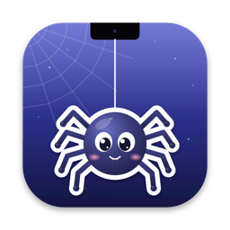
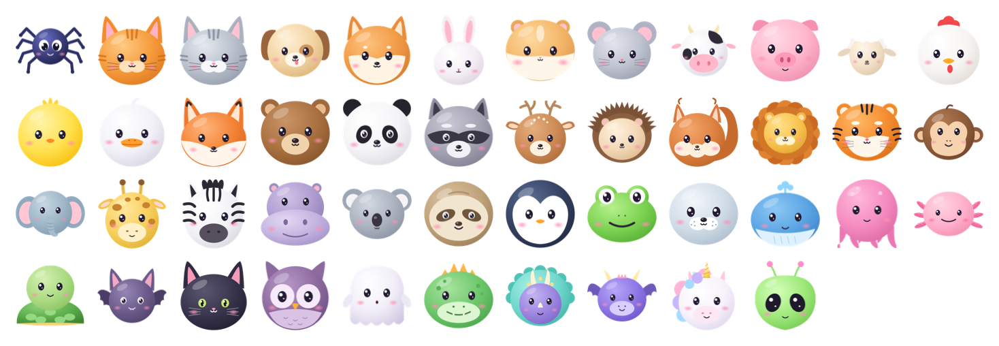

<p align="center">
  
</p>

<h1 align="center">SpiderNotch</h1>

<p align="center">
  A cute character lives in your Mac's notch.<br>
  Hover and it drops down on its thread. Click it for an app switcher. Play music and it shows what's playing.
</p>

<p align="center">
  <a href="https://github.com/ymmhzrtp7d-tech/SpiderNotch/releases/latest"></a>
  <a href="https://github.com/ymmhzrtp7d-tech/SpiderNotch/actions/workflows/ci.yml"></a>
  
  
  <a href="LICENSE"></a>
</p>

<p align="center">
  
</p>

## Features

- **46 characters** in 8 categories (pets, farm, forest, jungle, water, night, dinos, and the classic spider), each with blinking and smiling faces. Or make a **sticker from your own photo**: crop, zoom, remove the background, add a ring.
- **Hover the notch** and your character drops down on a thread, peeks out, or pops out and floats. Bump it with the cursor and it swings.
- **Click it** and an island springs out of the notch with all your open apps. Click one to switch (or use ← → and Return).
- **Now Playing**: while music or a video plays (Music, Spotify, Safari, Chrome, YouTube, and any app that reports to macOS), hovering shows the artwork, title, a seek bar, play/pause, next/previous and volume. Click the title to jump to the exact tab or track.
- **Works without a notch** too: external displays get a small pretend notch.
- **Updates itself**: checks GitHub once a day, shows what's new, installs with one click. Your settings and stickers are kept.
- **Private**: no account, no ads, no analytics. Photos never leave your Mac. See [PRIVACY.md](PRIVACY.md).

## Install

1. Download **`SpiderNotch-<version>.dmg`** from the [latest release](https://github.com/ymmhzrtp7d-tech/SpiderNotch/releases/latest).
2. Open it and drag **SpiderNotch** onto **Applications**.
3. Open SpiderNotch from your Applications folder. A little spider appears in the menu bar. Move your mouse to the notch and say hi.

**The first time only:** if macOS says it *"could not verify SpiderNotch"*, click **Done**, then open **System Settings → Privacy & Security**, scroll down and click **Open Anyway** next to SpiderNotch. This is because SpiderNotch isn't from the App Store (it can't be: Now Playing uses a system feature the App Store doesn't allow). More help: [Troubleshooting](docs/TROUBLESHOOTING.md).

### System requirements

| | |
|---|---|
| macOS | 14 Sonoma or newer (tested up to macOS 27) |
| Mac | Apple silicon (M1, M2, M3, M4, M5…) or Intel: one universal app |
| Screen | Best on MacBooks with a notch; works on any screen |
| Disk | About 15 MB |

### Updating

SpiderNotch checks for updates by itself once a day. You can also choose **Check for Updates…** from the spider menu, or open **Settings → Updates**. Updates install in place: no reinstalling, and your settings, characters and stickers are kept.

### Uninstall

Choose **Quit SpiderNotch** from the spider menu and drag SpiderNotch from Applications to the Trash. To also remove your stickers, delete `~/Library/Application Support/SpiderNotch`.

## Using it

| Do this | What happens |
|---|---|
| Hover the notch | Your character comes out (it blinks and smiles now and then) |
| Click the character | It hops, and the app switcher opens. Esc, a click outside, or moving away closes it |
| Play music or a video, then hover | The Now Playing island. Several things playing? Click the small app icons |
| Spider menu → **Characters…** | Pick an animal (double-click, or *Use This Character*) |
| Spider menu → **My Stickers…** | Make a sticker from a photo (Photos, Desktop, Downloads, or drop one in) |
| **Settings → Appearance** | Size, speed, entrance (thread, peek, pop), floating, swing, border, position |
| **Settings → Now Playing** | Turn it on/off, see what it can see, allow Music, Spotify and browsers |
| **Settings → General** | Enable, launch at login, show on screens without a notch |
| **Settings → Updates / About** | Check for updates, version, links, bug reports |

The first time you control Music or Spotify, or jump to a browser tab, macOS asks *"SpiderNotch wants to control …"*: click **Allow**.

## Feedback

- **Found a bug?** [Report it](https://github.com/ymmhzrtp7d-tech/SpiderNotch/issues/new?template=bug_report.yml) (or *Settings → About → Report a bug*, which fills in your version).
- **Have an idea?** [Request a feature](https://github.com/ymmhzrtp7d-tech/SpiderNotch/issues/new?template=feature_request.yml).
- **Security problem?** Please report it privately: see [SECURITY.md](SECURITY.md).

## Build it yourself

You need macOS 14+ and Apple's free Command Line Tools (Xcode is optional).

```bash
git clone https://github.com/ymmhzrtp7d-tech/SpiderNotch.git
cd SpiderNotch
bash "Install SpiderNotch.command"   # builds, installs into /Applications, opens it
bash scripts/test.sh                 # runs all the checks
```

- [CONTRIBUTING.md](CONTRIBUTING.md): how to contribute
- [DEVELOPING.md](DEVELOPING.md): building, adding characters, how Now Playing works
- [docs/RELEASING.md](docs/RELEASING.md): publishing a new version (automatic updates)
- [docs/ARCHITECTURE.md](docs/ARCHITECTURE.md): how the app is put together, and the plan for Windows
- [CLAUDE.md](CLAUDE.md): the guide for AI assistants working on this code
- [CHANGELOG.md](CHANGELOG.md): what changed in each version

## Licence

SpiderNotch is free and open source under the [MIT licence](LICENSE). Automatic updates use [Sparkle](https://sparkle-project.org) (MIT).

SpiderNotch is an independent project, not affiliated with Apple.
